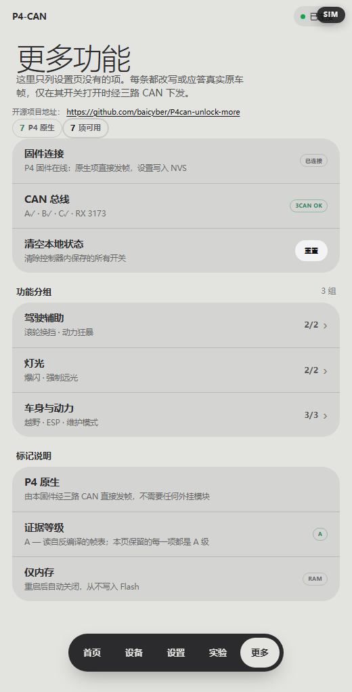

# P4can-unlock-more

> [!WARNING]
> **32 MB flash only** (Waveshare ESP32-P4-WIFI6 / rev3.2).
> The `app5M_fat24M_32MB` partition table does not fit a 16 MB board — flashing
> this image on 16 MB **bricks it**, and you will need USB to recover.
> For 16 MB you must build your own partition table, switch `FlashSize=32M` to
> `16M` and pick a 16 MB `PartitionScheme` before compiling. No 16 MB config
> ships with this repo.

Tesla CAN toolkit firmware for the **Waveshare ESP32-P4 WiFi6 3×TWAI** board.
Based on [P4can-universal-unlock](https://github.com/06066060606060/P4can-universal-unlock)
`v3.29.3`, with a new **More features** page and a firmware-update panel that
actually works end to end.



## Status — read this first

| | Status | Notes |
|---|---|---|
| More features page | ✅ works | 3 groups / **7 entries** + **TLSSC anti-restart**, bilingual; only what Settings does not already have |
| Firmware update (OTA) | ✅ works | upload a `.bin` in the browser, A/B partitions, rollback on failure |
| Local simulator | ✅ works | `sim/p4can-sim.html`, open it directly; three CAN buses up, no module installed |
| **`/api/feifan/*` endpoints** | ✅ **implemented** | `status` / `config` / `blob` / `action` / `module`; `gauge` still returns 503 |

### This P4 has no external TSL module

The original plan was to have the P4 drive a TSL module over BLE and write 44
config-block bit-fields. **The car does not have that module**, so the whole
path is dead. One channel survives on the page:

| Grade | Count | Channel | Page |
|---|---:|---|---|
| P4 native | 7 | the firmware builds and transmits the CAN frame itself (`feifan_super3can.h`) | green **P4 native**, writes answer `effect=applied` |

The other 123 entries — the old "needs module / needs new frame / awaiting
firmware / unreachable" buckets — **have been deleted from the page**. A switch
that cannot be flipped, or that flips and does nothing, has no business being
there. The raw 141 candidates stay in `data/feifan-menu-data.json` and
[docs/FEATURES.md](docs/FEATURES.md) for traceability.

The page also carries **only what Settings does not already have**. Settings
already exposes Nag Killer, ISA suppression, driver monitoring, visual speed
control, Auto Blinker, the LAB Auto Lane Change and Summon Heartbeat toggles,
and Appearance, so the 11 rows that were a second entry point to the same
handlers are gone:

| Removed here | id | Same thing in Settings |
|---|---|---|
| Nag Killer suppression | `d1a` | Settings → Nag Killer (`panelNag`, same `nagCfg`) |
| Hands-on-wheel suppression | `a1d` | same branch as `d1a` in the native layer |
| Turn-signal lane change | `d1b` | Settings → LAB → Auto Lane Change Enable |
| Gaze reminder suppression | `a1a` | Settings → Disable Driver Monitoring |
| ISA chime suppression | `a1b` | Settings → ISA Suppression |
| Disable visual speed limit | `a1c` | Settings → Visual Speed Control |
| EAP enhanced | `a3a` | Settings → Auto Blinker (`setAutoBlinkerEnabled`) |
| Summon heartbeat | `a3d` | Settings → LAB → Summon Heartbeat Override |
| Dark mode / Follow system / Scheduled dark | `s1a`/`s1b`/`s1c` | Settings → Appearance (system / light / dark) |

What is left is the seven things Settings has no equivalent for:

| id | What | Frame | Note |
|---|---|---|---|
| `q1a` | High-beam strobe | `0x249` | folded into the Lighting page; old id kept for API compatibility |
| `q1b` | Manual high beam | `0x3E9` | folded into the Lighting page; old id kept for API compatibility |
| `q1c` | Service mode | `0x339`, single frame | one frame per tap, no switch |
| `q1d` | Off-road mode | `0x2B6` | 3 rounds × 2 frames |
| `q1e` | ESP off · drift | `0x2B6` | 3 rounds × 2 frames |
| `q1f` | Power boost | `0x334` | `byte0 = 0xFF` |
| `q1g` | Scroll-wheel shift | `0x229` | only below 8 km/h |

`POST /api/feifan/config` still accepts the removed ids, so older clients and
external scripts do not start getting 404s — the page simply no longer shows
them. `q1x` is never written to NVS; the page re-reads `status.s3Config` on
load, so it cannot show a switch as "on" after a reboot silently reset it.

### The 8th entry: TLSSC anti-restart (the only switch saved in flash)

TLSSC Restore (Settings → Banned Car → TLSSC Restore) only does a
read-modify-retransmit of `0x331`: **the car sends a frame, we patch and echo
one back**. The touchscreen, however, reads the DAS config once while it boots
and latches it. If no patched `0x331` is on the bus at that moment, it latches
"banned" and you have to restart it by hand — which is why the restore used to
need a touchscreen restart on every power-up.

TLSSC anti-restart moves the patch in front of that boot-time read:

| Step | What it does |
|---|---|
| Cache | stores the patched `0x331` payload in NVS (at most one write per power cycle) |
| Replay | for 60 s after CAN B comes up it re-sends that cached frame at 10 Hz, without waiting for the car |
| Yield | as soon as the car itself sends `0x331` (fresh within 2 s) it stops and falls back to read-modify-retransmit |
| Stop | the window expires or 600 frames are sent, then it goes quiet for good |

Three limits, mirrored in `feifan_eap_norestart.h` and in the page copy:

- it only acts when **Banned Car** and **TLSSC Restore** are both on; otherwise
  it stores the switch, sends nothing, and the status row says what is missing;
- with no cached frame yet (first use) it sends nothing and the row says so;
- it goes over CAN B through the same TX barrier / admin hold / USB passive /
  epoch checks as every other injection.

It is the only entry on this page that persists to NVS (all `q1x` are
drive-session only), because the whole point is that nobody has to touch it
again after the first enable.

**On by default** since v3.29.3-nr2: a fresh install, and an upgrade from an
older build, both start with the switch on. Turn it off under
More → TLSSC anti-restart if you do not want it; that choice is persisted too.

**What it guarantees:** if this controller's CAN comes up before the touchscreen
reads its config, the touchscreen reads a `SELF_DRIVING` `0x331` and no manual
restart is needed; if the touchscreen reads later, the cached frame stays on the
bus for the whole window, so a later re-evaluation sees it too.

**What it cannot guarantee:** if the car broadcasts `0x331` continuously (this
firmware then yields and falls back to read-modify-retransmit) *and* the
touchscreen finished reading before our CAN was up, that one power-up still needs
a manual restart — that is bus timing, not something software can undo. Check
`stockRx` / `replayOk` / `cacheHex` in `status.eapNr` to see which case you are in.

### Five of the seven entries ported from SUPER_3CAN

SUPER_3CAN is an open-source three-bus CAN box (STM32F103 + dual MCP2515). It
does not reverse the checksum — it **reads the stock frame, edits bytes, then
looks up 16 pre-computed payloads by the frame's own counter `data[1] & 0x0F`**
and sends that back. Both the tables and the triggers now live in
`feifan_super3can.h`:

| Feature | Trigger | How |
|---|---|---|
| Service mode | button | `0x339`, one frame, `data[5] = 0x80` (bit7), no retry, no replay |
| Off-road mode | stock `0x2B6` | `60 00 00`, 2 frames × 3 rounds |
| ESP off · drift | stock `0x2B6` | `46 00 00`, 2 frames × 3 rounds |
| Power boost | stock `0x334` | `byte0 = 0xFF`, then fix the `0x334` additive checksum |
| Scroll-wheel shift | stock `0x229` | below 8 km/h, send `S3_GEAR_R/N/D/P[index]` |

Strobe headlights and forced high beam **no longer use that lookup table**. The
two lighting switches moved into a standalone **Lighting** page ported verbatim
from the author's v3.35.6 `lighting_reference_pure.h` (`feifan_lighting.h` is the
adapter). Four items there: manual high beam under AP, high-beam strobe, rear-fog
strobe, and dynamic brake lights. The old `q1a/q1b` ids are still accepted but
just forward into the new module, so nothing ends up with two implementations
fighting over the bus.

Three hard rules:

- **nothing is transmitted until the matching stock frame arrives**;
- **zero cost when every switch is off** — `feifanS3Observe()` returns on its first line;
- **never written to NVS** — an ignition cycle must return everything to off.

`tsl_ble.h` / `tsl_map.h` remain in the tree as an optional path, but the page no
longer exposes anything that needs them. The module link and the S3XY mapping are
mutually exclusive (one C6 BLE host): with S3XY on, the module link reports
`ble-busy` instead of fighting for the host.

**Not yet verified**: frame layouts and bit-fields come from static reverse
engineering of `TSL-Android.apk` and the Albert firmware (grade A evidence); the
SUPER_3CAN tables are copied from that project's source. Neither has been
captured against a real car. On the first drive, watch
`status.nativeConfig` / `status.s3Config` echo back before trusting a switch.

### Service mode: aligned with the official v3.35.0 implementation

Upstream `P4can-universal-unlock` is at v3.35.3; Service mode arrived in v3.35.0 and is
cleaner than the SUPER_3CAN variant:

| | Official (used) | SUPER_3CAN (dropped) |
|---|---|---|
| Frame | `0x339` VCSEC_authentication, DLC 8 | same |
| Payload | all zero except `data[5] = 0x80` (bit7) | `data[5] = 0xE0` (bits 5/6/7) |
| Count | **exactly one frame per tap** | three frames |
| Bus | BODY (CAN 1) | CAN B |

Bits 5 and 6 of `data[5]` have no justification in the official source, so only bit7 is set.
It passes the same gates: TX barrier held, not administratively held, not USB passive, all
three buses running, barrier epoch unchanged, and Summon admission when BODY is the B bus.
**No retry, no replay, never persisted.**

Whether the car actually entered is only visible in BODY `0x284 UI_vehicleModes` `d0 bit3`:

- `status.serviceConfig.confirmed=true` — the vehicle is in service mode
- `txOk>0` but `confirmed=false` — the frame went out, the car ignored it
- `lastErr` / `txFail` separate "gate closed" from "transmit failed"

One button under Body & drivetrain → Service; one tap sends one frame, and the line
underneath states the outcome.

## What is inside

**More features page** — 3 groups / 7 entries + TLSSC anti-restart:

| Group | Count | Contents |
|---|---|---|
| Drive assist | 2 | scroll-wheel shift (`0x229`), power boost (`0x334`) |
| Lighting (standalone page) | 4 | AP manual high beam, high-beam strobe, rear-fog strobe, dynamic brake lights |
| Body & drivetrain | 3 | off-road, ESP off, service mode |
| TLSSC | 1 | TLSSC anti-restart (`0x331` cached replay, the only persistent switch) |

The header only renders non-zero buckets, which is now `7 P4 native · 7 usable`.

The 8 native rows that used to live here (`d1a`/`d1b`/`a1a`/`a1b`/`a1c`/`a1d`/
`a3a`/`a3d`) plus the 3 local-UI rows all duplicated Settings and are gone from
the page; the mapping stays in `feifan_native.h` for compatibility.

All seven (plus TLSSC anti-restart) carry **grade A** evidence: bit offsets, masks and command bytes read
straight from the decrypted frame tables or an open-source data table. Nothing
on this page is inferred from UI naming any more.

Writes have exactly one path now: the frame builders in `feifan_super3can.h`,
replayed when the matching stock frame arrives. The page no longer has a "write
the TSL config block" path, and no local-UI fake switches either.

**Firmware update panel** — adds partition headroom, current version, drag and
drop, size/magic pre-checks, tap-twice confirmation, upload progress and
`Update.errorString()` translation on top of the stock `POST /update`.

**Lighting page** — a standalone page (Settings → Lighting) ported verbatim from
the author's v3.35.6 `lighting_reference_pure.h`. Four items: manual high beam
under AP (BODY `0x3E9` DAS bit, **no `0x249`**), high-beam strobe (three quick
stalk pulls to start, 70 ms on/off on BODY `0x249`), rear-fog strobe (right
scroll-wheel held + left wheel down, 20 flashes at 100 ms on BODY `0x273` d2
bit7), and dynamic brake lights (0/off, 1/light, 2/hard, merging `0x145` +
`0x39D` into BODY `0x3E9` d2 bit6). Rear fog passes byte0 through untouched —
the author found that writing byte0 fires "accessory on + lights on" and resets
the driver profile. All sends go through the TX barrier and the epoch gate;
`lighting249OwnerPure` arbitrates `0x249` so the turn signal yields to the
strobe. Config lives in NVS; endpoints are `/api/lighting/stats` and
`/api/lighting/update`.

**Wi-Fi relay** — the access point used to be the only radio mode, so a phone
joined to `P4-CAN` had no internet. The wireless page now takes your home SSID and
password and switches to `WIFI_AP_STA` with lwIP NAPT: clients keep `192.168.4.1`
as their gateway, the upstream DNS is pushed to them via the AP DHCP server
(`8.8.8.8` as fallback — skip that and you get "ping works, pages don't"), the
config lives in NVS under the `wifi` namespace, and a failed join is retried every
15 s without blocking the web server. `WiFi.mode(WIFI_OFF)` is never called: Wi-Fi
runs over esp-hosted (P4 + C6) and turning it off tears down the transport, after
which the page cannot be reached again.

**Packet capture** — a standalone page (Settings → Packet Capture) with bus
checkboxes (A/B/C), an optional single-ID filter, start/stop/clear, the latest
frames and CSV export. The buffer is a ring of 16384 rows in PSRAM (~256 KB, 2048
rows in internal RAM when PSRAM is absent); each row is `ms / id / bus / dlc /
data[8]`. It is read-only — capturing never transmits — and costs one `bool` test
per received frame while idle.

**Bilingual UI** — the dashboard ships in Chinese by default; the language switch
in the header flips to English and the choice is kept in `localStorage`. Dynamically
built strings (`Uploading 42%`) are patched via `MutationObserver`; technical
identifiers stay untranslated in Chinese mode.

## Flashing

Grab a build from [Releases](../../releases).

**`*-ota.bin` (~1.4 MB)** — for routine updates: connect to the P4 hotspot,
open `http://192.168.4.1` → Settings → Firmware update, pick the file, tap twice.
OTA only writes the app partition — bootloader, partition table and flash
parameters cannot be changed this way.

**`*-full.bin` (32 MB)** — first flash or unbrick:

```bash
esptool.py --chip esp32p4 -p <PORT> -b 460800 write_flash 0x0 P4can-unlock-more-v3.29.3-more1117-full.bin
```

ESP32-P4 layout differs from S3: `0x2000` bootloader (`E9`), `0x8000` partition
table (`AA50`), `0x10000` app (`E9`); `0x0` is blank `0xFF`.

## Build from source

Arduino-ESP32 core **3.3.12**, `firmware/P4can-unlock-more/` is the sketch:

```text
esp32:esp32:esp32p4:ChipVariant=postv3,FlashSize=32M,PartitionScheme=app5M_fat24M_32MB,PSRAM=enabled,USBMode=hwcdc,CDCOnBoot=cdc,FlashMode=qio
```

```bash
python tools/more/pack_ota.py            # rebuild page → compile → pack → verify
python tools/more/pack_ota.py --no-html  # page unchanged
python tools/more/pack_ota.py --dry-run  # environment check only
```

The script aborts instead of shipping a bad image: it rejects anything larger
than `0x480000`, anything whose first byte is not `0xE9`, any `merged.bin` that
is not 32 MB with valid magic at the three offsets, and any image whose embedded
gzip page does not match `dashboard_source.html` byte for byte.

## Local preview

```bash
python tools/more/build_sim.py
```

Extracts the page from `index_html.h`, injects a fake backend and writes
`sim/p4can-sim.html`. Open it and click through the whole flow; the SIM panel
shows every request with method, path and payload. Debugging aid only — not a
substitute for hardware testing.

## Layout

```text
firmware/P4can-unlock-more/   sketch (.ino, headers, dashboard)
tools/more/                   generators, injectors, packer, simulator builder
data/feifan-menu-data.json    141 candidate entries, 44 bit-fields, command/API tables (page shows 7)
docs/                         FEATURES / PROTOCOL / OTA / REVERSE
sim/p4can-sim.html            ready-to-open simulator
```

### Documentation

| Doc | Contents |
|---|---|
| [docs/FEATURES.md](docs/FEATURES.md) | all 141 candidates with evidence grade, frame/bit-field, landing status (incl. the ones removed from the page) |
| [docs/PROTOCOL.md](docs/PROTOCOL.md) | frame format, command bytes, 44 bit-fields, `0xBB` values, API contract |
| [docs/OTA.md](docs/OTA.md) | partitions, rollback, the 7 packing steps, acceptance checks |
| [docs/REVERSE.md](docs/REVERSE.md) | how the three sources were unpacked, corrections, dedup rules |

## Hardware

Waveshare ESP32-P4-WIFI6, rev3.2, 32 MB flash, `app5M_fat24M_32MB` partition
scheme. `ota_0` / `ota_1` are `0x480000` (4.5 MB) each; the per-image ceiling is
4,718,592 B.

| Bus | TWAI | TX | RX |
|---|---|---|---|
| CAN 1 BODY | 0 | GPIO20 | GPIO21 |
| CAN 2 CHASSIS | 1 | GPIO22 | GPIO23 |
| CAN 3 PARTY | 2 | GPIO26 | GPIO27 |

## Known limitations

- **No external TSL module is installed on this board**, so the 123 entries that
  needed it (or that were missing a frame, or unreachable over the three CAN
  buses) are **no longer rendered at all**. The candidate data stays in
  `data/feifan-menu-data.json` and [docs/FEATURES.md](docs/FEATURES.md).
- **15 items are native to the P4 firmware** (`feifan_native.h` +
  `feifan_super3can.h`): they call existing setters in `vehicle_logic.h` /
  `continuous_ap_runtime.h`, or build the frame themselves, and transmit over
  the three buses. `status.applied`, `status.nativeConfig` and
  `status.s3Config` are the authoritative source for what is really on.
- The SUPER_3CAN tables are copied verbatim from that project's source, with
  **no real-car capture** behind them. `0x2B6` / `0x339` / `0x334` touch the
  drivetrain and braking domains — try them on a closed course first.
- `GET /api/feifan/gauge` still returns 503: the 0xB0 cluster / 0x5D9 tyre
  payloads are not decoded.
- `0x249 / 0x10C / 0x3E2 / 0x3E3` from the design mock-ups appear zero times in
  either firmware. Those features were rewritten against real bit-fields; the
  frame IDs are footnotes, do not send them.
- Partition table, bootloader and flash parameters require a wired flash.
- No write behaviour has been validated on a real car.

## Safety

Built for **closed-course debugging**. Changing lighting, horn, nag suppression
or driver-monitor behaviour on public roads may be illegal and may put the
vehicle into a non-certified state. Use at your own risk; the authors accept no
liability. Not affiliated with Tesla, Inc.

## Support the project

> Free and open source. If it saved you an evening of debugging, you can buy the
> author a coffee.

<table>
  <tr>
    <td align="center"><br><sub><b>Alipay</b></sub></td>
    <td align="center"><br><sub><b>WeChat Reward</b></sub></td>
  </tr>
</table>

## Contact

<table>
  <tr>
    <td align="center"><br><sub><b>Douyin · @耶基大学懂事长</b><br>ID <code>yejiuni</code></sub></td>
    <td align="center"><br><sub><b>WeChat · scan to add</b></sub></td>
  </tr>
</table>

## License

Additions are MIT — see [LICENSE](LICENSE). The firmware baseline keeps its
upstream terms — see [NOTICE](NOTICE).

---

[中文](README.md)
