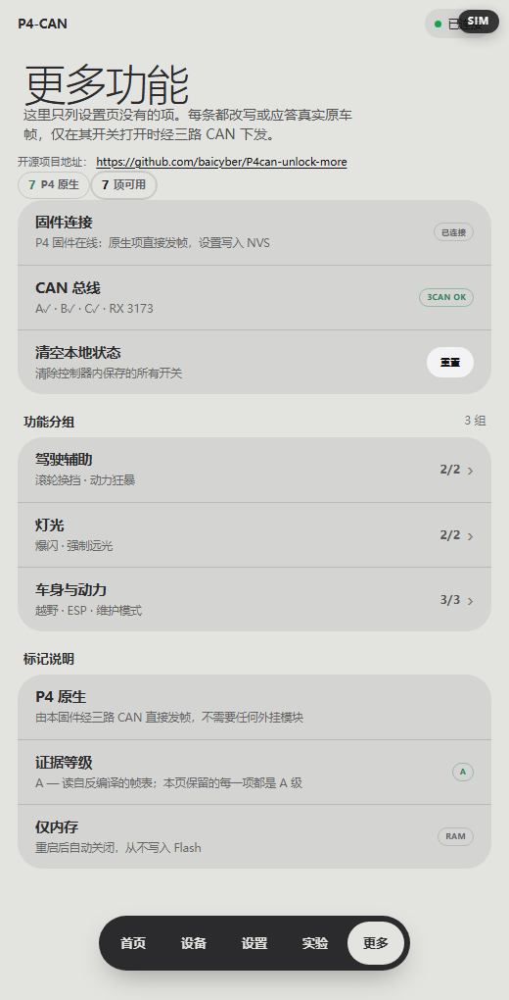
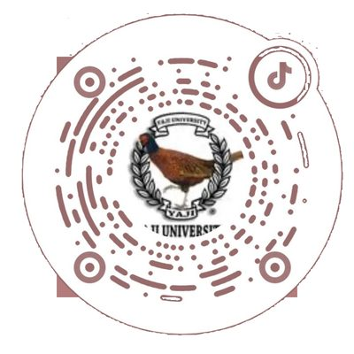

# P4can-unlock-more

> [!WARNING]
> **只适用于 32 MB Flash 的板子**（微雪 ESP32-P4-WIFI6 / rev3.2）。
> **16 MB 版本刷这个包会直接变砖** —— 分区表 `app5M_fat24M_32MB` 与 16 MB flash 不匹配，烧进去连 bootloader 都起不来，只能用 USB 重新救回来。
> 16 MB 需要自己改 `large_fat_32MB.csv` 一类分区表、把 FQBN 里的 `FlashSize=32M` 换成 `16M`、`PartitionScheme` 换成 16 MB 方案，然后重新编译。仓库里没有现成的 16 MB 配置。

给 **Waveshare ESP32-P4 WiFi6 3×TWAI** 板子的特斯拉 CAN 工具固件。
在 [P4can-universal-unlock](https://github.com/06066060606060/P4can-universal-unlock) `v3.29.3` 的看板上，新增一页**「更多功能 / More features」**，并把固件更新面板补成能真正用的一次性流程。

**界面默认中文**，右上角语言开关可切英文，选择记在 `localStorage`，重启后保持。



---

## 先说清楚现状

| | 状态 | 说明 |
|---|---|---|
| 「更多功能」页面 | ✅ 可用 | 3 组 **7 项** + **TLSSC 免重启**，中英双语；只放设置页没有的东西，不重复 |
| 固件更新（OTA） | ✅ 可用 | 网页上传 `.bin`，双分区 A/B，失败可回滚 |
| 本地模拟预览 | ✅ 可用 | `sim/p4can-sim.html`，双击即开；默认三路 CAN 在线、默认**无外挂模块** |
| **`/api/feifan/*` 后端端点** | ✅ **可用** | `status` / `config` / `blob` / `action` / `module` 已实现；`gauge` 仍是 503 |

### 前提：这台 P4 没有外挂 TSL 模块

最初方案是让 P4 通过 BLE 连 TSL 外挂模块，把 44 个配置位域写进模块配置块。
**实机并没有装这个模块**，那条链路是死的。所以页面上只剩一条真能落地的通道：

| 档 | 数量 | 落地通道 | 页面表现 |
|---|---:|---|---|
| P4 原生 | 7 | 固件按原车帧构造并发出 CAN 帧（`feifan_super3can.h`） | 绿标「P4 原生」，写入回 `effect=applied` |

原来标「需模块 / 需新增 / 待固件 / 不可达」的 123 条**已经从页面删掉，不再展示**——
拨不动的开关、拨了也不生效的行留着只会误导人。原始 141 条候选仍保留在
`data/feifan-menu-data.json` 与 [docs/FEATURES.md](docs/FEATURES.md) 里做追溯。

而且只放**设置页没有的**。设置页已经有 Nag Killer、ISA 抑制、驾驶员监测、视觉限速、
Auto Blinker、LAB 里的 Auto Lane Change 与 Summon Heartbeat、以及 Appearance 主题，
「更多功能」里对应的 11 行是同一批函数的第二个入口，属于重复，本轮一并删掉：

| 删掉的项 | id | 设置页里的同一项 |
|---|---|---|
| Nag Killer 抑制 | `d1a` | Settings → Nag Killer（`panelNag`，同一份 `nagCfg`） |
| 脱手检测抑制 | `a1d` | 同上，原生层里与 `d1a` 是同一个分支 |
| 打灯变道 | `d1b` | Settings → LAB → Auto Lane Change Enable |
| 注视提醒抑制 | `a1a` | Settings → Disable Driver Monitoring |
| ISA 提示音抑制 | `a1b` | Settings → ISA Suppression |
| 禁用视觉限速 | `a1c` | Settings → Visual Speed Control |
| EAP 增强 | `a3a` | Settings → Auto Blinker（`setAutoBlinkerEnabled`） |
| 召唤心跳 | `a3d` | Settings → LAB → Summon Heartbeat Override |
| 深色模式 / 跟随系统 / 定时深色 | `s1a`/`s1b`/`s1c` | Settings → Appearance（system / light / dark） |

保留了 7 项，都是设置页完全没有、只有 SUPER_3CAN 才有的车控：

| id | 名称 | 帧 | 备注 |
|---|---|---|---|
| `q1a` | 远光灯频闪 | `0x249` | 已并入「灯光功能」整页，旧 id 保留兼容 |
| `q1b` | 手动开远光 | `0x3E9` | 已并入「灯光功能」整页，旧 id 保留兼容 |
| `q1c` | 维护模式（Service mode） | `0x339` 单帧 | 每次点击只发一帧，无开关 |
| `q1d` | 越野模式 | `0x2B6` | 3 轮 × 2 帧 |
| `q1e` | 关闭 ESP · 漂移 | `0x2B6` | 3 轮 × 2 帧 |
| `q1f` | 动力狂暴 | `0x334` | `byte0 = 0xFF` |
| `q1g` | 滚轮换挡 | `0x229` | 车速 ≤ 8 km/h 才发 |

`POST /api/feifan/config` 仍认原来那批 id（老客户端、外部脚本调用不会 404），
只是页面不再暴露它们。`q1x` 不写 NVS，重进页面由 `status.s3Config` 覆盖成固件真值，
避免留下「重启后其实已恢复默认」的假状态。

### 第 8 项：TLSSC 免重启（唯一一个常驻开关）

TLSSC 恢复（设置页「被封车辆 → TLSSC 恢复」）只做 `0x331` 的读-改-重发：
**车发一帧，我们改一帧**。而车机只在自己启动时读一次 DAS 配置并锁存 ——
那一刻总线上要是还没有被改过的 `0x331`，车机就锁存「封禁」，得人工重启
车机才重读。于是变成「每轮上电都要捅一次」。

TLSSC 免重启把这个动作提前到车机读配置之前：

| 步骤 | 做法 |
|---|---|
| 缓存 | 把补丁后的 `0x331` 载荷存进 NVS（每个上电周期最多写一次，护 flash） |
| 补发 | 每次上电 CAN B 就绪后开 60 s 窗口，以 10 Hz 补发缓存帧，不等车先发 |
| 让位 | 车自己开始发 `0x331`（2 s 内有新鲜帧）就立刻停手，回到读-改-重发 |
| 收尾 | 窗口到期或补到 600 帧彻底停手，不会无限期造帧 |

三条边界写在 `feifan_eap_norestart.h` 顶部注释里，也和页面文案一致：

- 只在「被封车辆」+「TLSSC 恢复」都开着时才动作；少一个就只存开关、不发帧，
  页面的状态行会直接写「缺前提」，不假装在工作；
- 没有缓存帧（第一次用）就什么都不发，状态行显示「待首帧」；
- 走 CAN B，过与其它注入相同的 TX 屏障 / 管理员挂起 / USB 被动 / epoch 检查。

它是「更多功能」里**唯一写 NVS 的开关**（其余 `q1x` 都是本行车会话级），
因为它的全部意义就是「以后每轮上电都不用人再点一次」。

**默认开启**（v3.29.3-nr2 起）：首次刷入或由旧版升级后开关即为开；
若不想用，到「更多功能 → TLSSC 免重启」关掉即可，之后会记住关闭状态。

**能保证什么：** 只要本机 CAN 比车机读配置先上线，车机读到的就是
`SELF_DRIVING` 的 `0x331`，不用人工重启；即使车机晚读，缓存帧也会在窗口内
一直挂在总线上，车机后置重新评估时同样能看到。

**不能保证什么：** 如果这辆车的 `0x331` 是周期性常发（本机会让位，改走
读-改-重发），而车机又在本机 CAN 上线之前就读完了配置，那一次仍然需要人工
重启一次车机 —— 这是总线时序决定的，软件补不回来。实车是否还需要重启，
以 `status.eapNr` 的 `stockRx` / `replayOk` / `cacheHex` 三个读数判定。

### 7 项里有 5 项来自 SUPER_3CAN（本轮移植）

SUPER_3CAN 是一个 STM32F103 + 双 MCP2515 的三路 CAN 盒子工程。
它不逆推校验算法，而是**读原车帧 → 改字节 → 按帧自带计数器 `data[1] & 0x0F` 查 16 项预计算表**。
这套表和触发条件搬进了 `feifan_super3can.h`：

| 能力 | 触发 | 做法 |
|---|---|---|
| 维护模式 | 按钮 | `0x339` 单帧，`data[5] = 0x80`（bit7），不重试不重放 |
| 越野模式 | 收到 `0x2B6` | `60 00 00`，2 帧 × 3 轮 |
| 关闭 ESP · 漂移 | 收到 `0x2B6` | `46 00 00`，2 帧 × 3 轮 |
| 动力狂暴 | 收到 `0x334` | `byte0 = 0xFF` 后补 `0x334` 加和校验 |
| 滚轮换挡 | 收到 `0x229` | 车速 ≤ 8 km/h 时按 `index` 取 `S3_GEAR_R/N/D/P[16][3]` 回发 |

灯光相关两项已**移出 SUPER_3CAN，并入独立的「灯光功能」整页**（作者 v3.35.6，
见下一节）。SUPER_3CAN 那版发错总线（标准 3/Y 下 `p4CanSendB()` 是 CHASSIS）且
要求原车帧已经拉住杆，车上完全没反应；作者版走 BODY、自己拉杆、CRC8 现算。

三条硬约束：

- **只在收到对应原车帧时才回发**——原车帧不来，一个字节都不发；
- **开关全关时零开销**，`feifanS3Observe()` 头一行就返回；
- **不写 NVS**，车熄火重启必须回到关闭。

`tsl_ble.h` / `tsl_map.h` 仍然留在源码里作为可选链路，但页面已经不再暴露需要它的条目，
只有显式启用模块才会工作；BLE 由 C6 协处理器提供，模块链路与 S3XY 映射互斥
（S3XY 开着时模块链路直接报 `ble-busy`，不会去抢同一个 host）。

**仍未验证**：帧格式与位域来自 `TSL-Android.apk` 与 Albert 固件的静态逆向（证据等级 A），
SUPER_3CAN 的查表值来自开源工程源码，两者都**没有实车抓包对照**。
第一次上车建议先看 `status.nativeConfig` / `status.s3Config` 的回显是否自洽，再逐项确认。

---

### 维护模式：对齐官方 v3.35.0 的 Service mode

官方上游 `P4can-universal-unlock` 到 v3.35.3，v3.35.0 才加的 Service mode。做法比 SUPER_3CAN 干净：

| | 官方（已采用） | SUPER_3CAN（已弃用） |
|---|---|---|
| 帧 | `0x339` VCSEC_authentication，DLC 8 | 同 |
| 载荷 | 全 0，仅 `data[5] = 0x80`（bit7） | `data[5] = 0xE0`（bit5/6/7 一起置） |
| 次数 | **每次点击只发一帧** | 连发 3 次 |
| 总线 | BODY（CAN 1） | CAN B |

`data[5]` 的 bit5/bit6 在官方实现里没有任何依据，所以按官方只置 bit7。
发送前过同一套闸门：TX 屏障在、非管理员挂起、非 USB 被动、三路总线都跑着、
屏障 epoch 未变、BODY 不是 B 路时还要过 Summon 准入。**失败不重试、不重放、不落盘。**

车端是否真的进去了，只看 BODY 总线 `0x284 UI_vehicleModes` 的 `d0 bit3`：

- `status.serviceConfig.confirmed=true` → 车辆已进入维护模式
- `txOk>0` 但 `confirmed=false` → 帧发出去了，车没认（车机屏幕没反应就是这种情况）
- `lastErr` 与 `txFail` 区分「闸门没开」和「发送失败」

页面「车身与动力 → 维护」一行一个按钮，点一次发一次，下方状态行直接写结论。

## 它做了什么

### 1. 更多功能页（3 组 / 7 项 + TLSSC 免重启）

| 分组 | 项数 | 内容 |
|---|---|---|
| 驾驶辅助 | 2 | 滚轮换挡（`0x229`）、动力狂暴（`0x334`） |
| 灯光功能 | 4 | 独立整页（作者 v3.35.6）：AP 手动远光、远光频闪、后雾灯频闪、动态刹车灯 |
| 车身与动力 | 3 | 越野模式、关闭 ESP、维护模式（Service mode） |
| TLSSC | 1 | TLSSC 免重启（`0x331` 缓存补发，唯一常驻开关） |

首页统计条只渲染非零档，现在就是 `7 P4 原生 · 7 项可用`。

存档里原来那 8 项原生（`d1a`/`d1b`/`a1a`/`a1b`/`a1c`/`a1d`/`a3a`/`a3d`）与 3 项本地 UI
都跟设置页重复，页面上已删除，只保留在 `feifan_native.h` 的映射表里做兼容。

7 项（含 TLSSC 免重启）全部是**证据等级 A**：位域偏移、掩码、命令字节直接读自反编译的帧表
或开源工程的数据表，没有靠界面命名推断的项。

写入路径只有一条：走 `feifan_super3can.h` 的帧构造器，在原车帧到达时回发。
页面不再有「写 TSL 配置块位域」这条路径，也没有本地 UI 假开关。

### 2. 固件更新面板

上游已经有可用的 `POST /update` + `GET /api/ota/status`，缺的是前端：
现在补上了分区余量、当前版本、拖拽选文件、大小/魔数预检、二次确认、
上传进度与 `Update.errorString()` 的错误码翻译。

### 3. 中英双语

页面顶部语言开关联动整站。动态拼接的文案（`Uploading 42%`）用
`MutationObserver` 兜底，中文模式下技术标识（帧 ID、位域、API、FQBN）保持原样。

### 4. 灯光功能（作者 v3.35.6 整页）

设置页「灯光功能」四项，算法逐字取自作者的 `lighting_reference_pure.h`：

| 开关 | 触发 | 帧与位域 |
|---|---|---|
| 自动驾驶时手动开远光 | AP 中推一次杆开、再推一次关 | BODY `0x3E9` d1 bit4 + 清 d3 bit0，**不发 0x249** |
| 远光灯频闪 | 3 s 内连拉三次启动、再拉一次停 | BODY `0x249` 方波，亮/灭各 70 ms |
| 后雾灯频闪 | 按住右滚轮 + 左滚轮下滚 | BODY `0x273` d2 bit7，20 次、100 ms 半周期 |
| 动态刹车灯（关/轻踩/深踩） | 踩刹车 | 0x145 + 0x39D 合并，写 BODY `0x3E9` d2 bit6 |

- 后雾灯只改 d2 bit7，**byte0 原样透传**：作者实测写 byte0 会误发「附件上电 + 灯开关 ON」，
  触发驾驶员档案重置
- 四项统一走 TX 屏障；0x249 多主用 `lighting249OwnerPure` 裁定，爆闪占用时转向灯让位
- 配置存 NVS `features/lighting`，断电保持；接口 `/api/lighting/stats` 与 `/api/lighting/update`

### 5. Wi-Fi 中继（连上 P4 也有网）

原来 P4 只开 AP：手机连上 `P4-CAN` 就没外网，想看个文档得先切回家里 Wi-Fi，
看完再切回来，页面还得重连一次。

现在无线页多了一张 **WI-FI RELAY · UPSTREAM** 卡片：填家里 Wi-Fi 的 SSID 和密码，
点「作为中继连接」，P4 就变成 AP+STA：

```
手机 ──Wi-Fi──> P4-CAN (192.168.4.1) ──STA──> 家里路由器 ──> 外网
```

- 模式是 `WIFI_AP_STA`，AP 网段仍是 `192.168.4.1`，原来的访问方式不变
- 转发用 lwIP 的 NAPT（`esp_netif_napt_enable`），不靠额外路由
- AP 的 DHCP 会把**上游 DNS** 一起下发（兜底 `8.8.8.8`）。这步最容易被漏：
  漏了就变成「能 ping 通 IP、打不开网页」
- 配置落 NVS（`wifi` 命名空间），断电重启自动恢复
- 连不上每 15 s 重试，状态由 `loop()` 每秒轮询，不阻塞页面
- 点「停止中继」只断 STA、退回纯 AP，AP 不重启，页面不掉线

**不会**调 `WiFi.mode(WIFI_OFF)` / `WiFi.disconnect(true)`：本机 Wi-Fi 走 esp-hosted
（P4 + C6），把 Wi-Fi 关掉会连 Hosted 传输一起拆掉，之后页面就再也连不回来了。

接口：`GET /api/wifi/uplink`、`POST /api/wifi/uplink?ssid=…&password=…`、
`POST /api/wifi/uplink?off=1`。

### 6. 抓包页（抓帧 + 导 CSV）

设置 → **Packet Capture**：选总线（A/B/C 多选）、可选只抓某个 ID、按开始、
按停止、点「下载 CSV」。跟 LAB 里那套「研究抓包」是两回事 —— 那个要标注场景、
只留触发点前后，这里就是原样整段录下来。

- 环缓冲 16384 行（≈256 KB，放 PSRAM；没有 PSRAM 退内部 RAM 2048 行），满了覆盖最旧
- 每行 `ms / id / bus / dlc / data[8]`
- **只读**：抓包不发任何帧
- 关着的时候每个收帧只多一次 `bool` 判断

接口：`/api/capture/status|start|stop|clear|frames|export.csv`。

---

## 刷机

到 [Releases](../../releases) 下载，两种包，按需选：

### 升级包 `*-ota.bin`（约 1.4 MB）—— 平时更新用

1. 手机/电脑连上 P4 的热点
2. 打开 `http://192.168.4.1` → **设置 → 固件更新**
3. 选 `P4can-unlock-more-v3.29.3-more1117-ota.bin`
4. 点一下，再点一下确认，等进度条走完自动重启

OTA 只写 app 分区，**改不了 bootloader、分区表和 flash 参数**。

### 完整包 `*-full.bin`（32 MB）—— 首次烧录 / 救砖用

```bash
esptool.py --chip esp32p4 -p <PORT> -b 460800 write_flash 0x0 P4can-unlock-more-v3.29.3-more1117-full.bin
```

整片镜像布局（ESP32-P4 与 S3 不同，`0x0` 是空白 `0xFF`）：

| 偏移 | 内容 |
|---|---|
| `0x2000` | bootloader（magic `E9`） |
| `0x8000` | 分区表（magic `AA50`） |
| `0x10000` | 应用镜像（magic `E9`） |

每个 Release 都附 `manifest.json`，含两个包的 sha256、大小、分区余量、
FQBN 与页面指纹，刷完可以对照页面上的版本号核对。

---

## 从源码编译

需要 **Arduino-ESP32 core 3.3.12** 与 `arduino-cli`（或 Arduino IDE 2.x）。

```text
esp32:esp32:esp32p4:ChipVariant=postv3,FlashSize=32M,PartitionScheme=app5M_fat24M_32MB,PSRAM=enabled,USBMode=hwcdc,CDCOnBoot=cdc,FlashMode=qio
```

`firmware/P4can-unlock-more/` 就是 sketch 目录，直接用 IDE 打开即可编译。

### 一条命令出两个包

```bash
python tools/more/pack_ota.py            # 重建页面 → 编译 → 出包 → 校验
python tools/more/pack_ota.py --no-html  # 页面没改，跳过 gzip 重建
python tools/more/pack_ota.py --dry-run  # 只检查环境
```

脚本会做 7 步，任一步不合规直接中止：

1. 重跑 `gen_feifan.py` → `integrate_feifan.py` → `patch_ota.py`，再 gzip 成 `index_html.h`
2. 同步源码到 `build/` 编译副本，改写 `FW_VERSION` 打版本标
3. `arduino-cli compile`
4. 提取 `.ino.bin`，校验大小 ≤ `0x480000`、首字节 `0xE9`
5. 提取 `.merged.bin`，校验 32 MB 与三个关键偏移
6. **逐字节比对**镜像内嵌 gzip 与 `dashboard_source.html`（防止页面没同步进去）
7. 写 `dist/manifest.json`

`arduino-cli` 找不到时按 `ARDUINO_CLI` 环境变量 → `PATH` → `tools/` 顺序查找。

---

## 本地预览（不刷板）

```bash
python tools/more/build_sim.py
```

从 `index_html.h` 解出页面，注入假后端，输出 `sim/p4can-sim.html`。
双击打开即可点完整流程：假 `/api/feifan/*`、假 OTA 进度、右下角 SIM 面板
能看到每个请求的方法、路径、payload 与最近动作。

> 这是调试页面用的，不能替代真机验证。

---

## 目录结构

```text
firmware/P4can-unlock-more/     固件 sketch（.ino + 头文件 + 页面）
  dashboard_source.html         可编辑的看板源码（注入块标了 P4CAN-* 注释）
  index_html.h                  由它 gzip 生成的嵌入头，不要手改
  tools/                        上游自带的构建脚本
tools/more/
  build_more.py                 合并三路来源 → data/feifan-menu-data.json
  gen_feifan.py                 生成页面/CSS/JS/翻译片段
  integrate_feifan.py           5 处注入看板（幂等，先删旧块）
  patch_ota.py                  固件更新面板增强（幂等）
  pack_ota.py                   编译 + 出包 + 校验
  build_sim.py                  生成本地模拟页
data/feifan-menu-data.json      141 条候选条目 + 44 个位域 + 命令/API 定义（页面只展示设置页没有的 7 条）
docs/                           FEATURES / PROTOCOL / OTA / REVERSE
sim/p4can-sim.html              本地模拟页（可直接打开）
```

---

### 详细文档

| 文档 | 内容 |
|---|---|
| [docs/FEATURES.md](docs/FEATURES.md) | 141 条候选全表，逐项标注证据等级、帧/位域、落地方式（含已从页面移除的项） |
| [docs/PROTOCOL.md](docs/PROTOCOL.md) | 帧格式、命令字、44 个位域、`0xBB` 快捷键值、前端契约 |
| [docs/OTA.md](docs/OTA.md) | 分区/回滚机制、打包 7 步、验收清单、离线校验 |
| [docs/REVERSE.md](docs/REVERSE.md) | 三路来源怎么拆的、纠错记录、去重决策、还没搞清的 |

---

## 硬件与接线

板子：Waveshare ESP32-P4-WIFI6，rev3.2，32 MB flash，`app5M_fat24M_32MB` 分区。
`ota_0` / `ota_1` 各 `0x480000`（4.5 MB），单包上限 4,718,592 B。

| 总线 | TWAI | TX | RX |
|---|---|---|---|
| CAN 1 BODY | 0 | GPIO20 | GPIO21 |
| CAN 2 CHASSIS | 1 | GPIO22 | GPIO23 |
| CAN 3 PARTY | 2 | GPIO26 | GPIO27 |

---

## 已知限制

- `gauge` 仍是 503：0xB0 仪表、0x5D9 胎压载荷没解码，页面显示「等待固件」。
- 原「需模块 / 需新增 / 待固件 / 不可达」的 123 条**已从页面移除**，不再展示也不再锁定：
  它们要么依赖本机没有的 TSL 模块，要么缺 CAN 帧定义，要么走座舱以太网三路 CAN 够不到。
  候选数据仍在 `data/feifan-menu-data.json`，想看追溯可以翻 [docs/FEATURES.md](docs/FEATURES.md)。
- `tsl_ble.h` 的帧格式、校验、44 个位域来自静态逆向，**没有实车抓包对照**。
  首次上车先看 `status.module.cfgLen` 与 `0xA3` 回读值是否自洽，再批量改设置。
- SUPER_3CAN 的查表值直接照抄开源工程，**没有实车对照**过；`0x2B6` / `0x339` / `0x334`
  这三条改的是动力与制动域，先在封闭场地确认。
- 模块链路与 S3XY 映射互斥（同一个 C6 BLE host）：S3XY 开启时模块链路报 `ble-busy`。
- 设计图上的 `0x249 / 0x10C / 0x3E2 / 0x3E3` 在 Albert 固件与 P4 源码里命中 0 次，
  这几个功能已按真实位域重写，帧号只作脚注保留，别照着发帧。
- 分区表、bootloader、flash 参数只能线刷，OTA 无法更改。
- 没有在实车上验证过任何一项写入行为。

---

## 安全与合规

这是给**封闭场地调试**用的工具。改动车身行为（灯光爆闪、脉冲喇叭、
免打扰抑制、驾驶员监控抑制）在公共道路上可能违法，也可能让车辆进入
不符合型式认证的状态。

- 一切后果自负，作者不承担任何责任
- 不要在公共道路使用影响灯光、喇叭、限速识别的功能
- 刷机前确认你有办法救砖（完整包 + USB 线）

与特斯拉公司无任何关联。特斯拉、Model 3/Y 等商标归其所有者。

---

## 致谢

- [P4can-universal-unlock](https://github.com/06066060606060/P4can-universal-unlock) —— 固件基线
- [204442021](https://github.com/204442021) —— 功能清单与逆向素材
- [P4can-universal-unlock 生态](https://github.com/06066060606060) 的其他贡献者

## ☕ 赞助

> 项目完全开源免费。如果它帮你省下了折腾的时间，欢迎请作者喝杯咖啡，助力后续更新~

<table>
  <tr>
    <td align="center"><br><sub><b>支付宝</b></sub></td>
    <td align="center"><br><sub><b>微信赞赏</b></sub></td>
  </tr>
</table>

## 📮 联系作者

> 装不上、刷完了没反应、想加功能，都可以来找我。

<table>
  <tr>
    <td align="center"><br><sub><b>抖音 · @耶基大学懂事长</b><br>抖音号 <code>yejiuni</code></sub></td>
    <td align="center"><br><sub><b>微信 · 扫码加好友</b></sub></td>
  </tr>
</table>

## License

新增部分 MIT，见 [LICENSE](LICENSE)；固件基线的版权与条款见 [NOTICE](NOTICE)。

---

[English](README.en.md)
